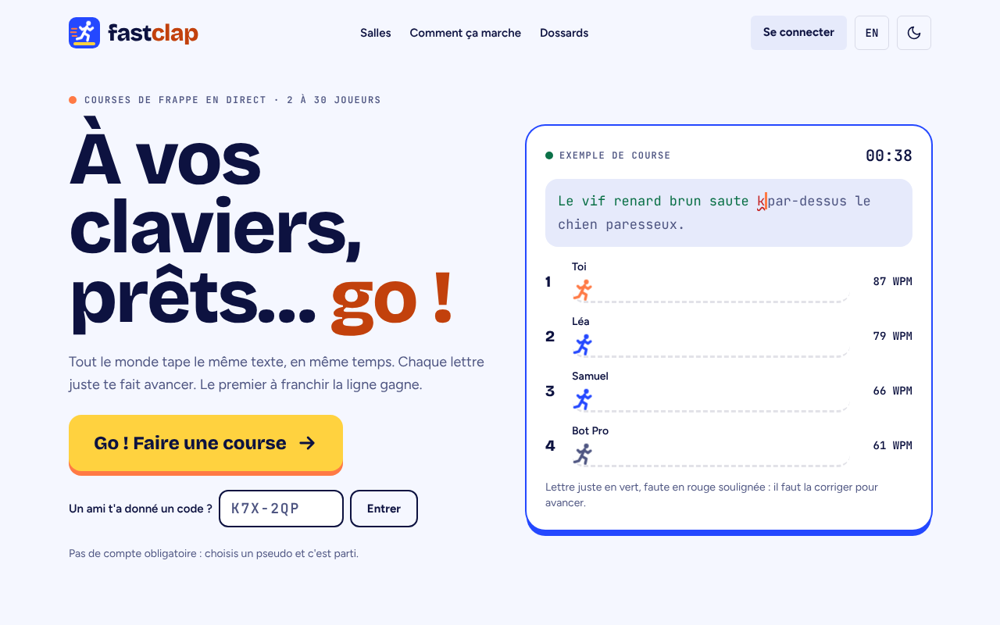
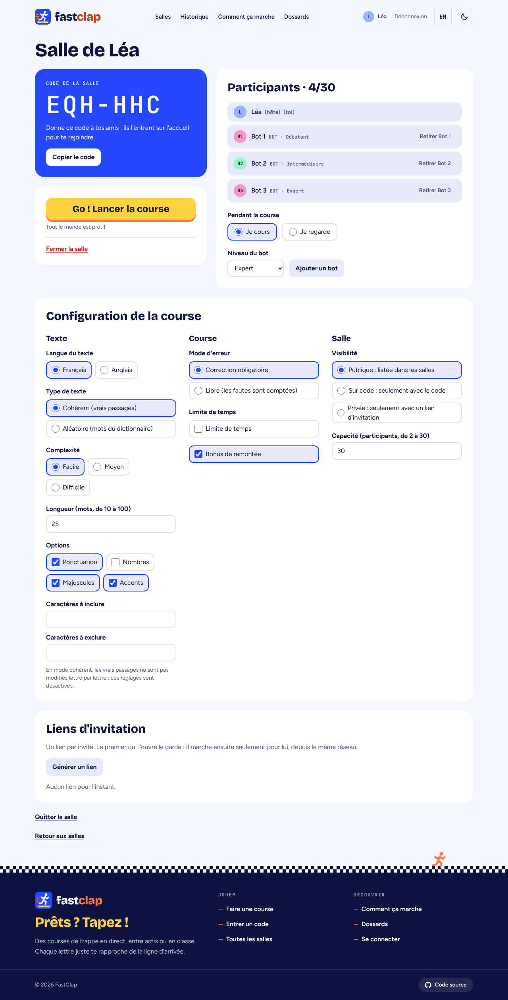
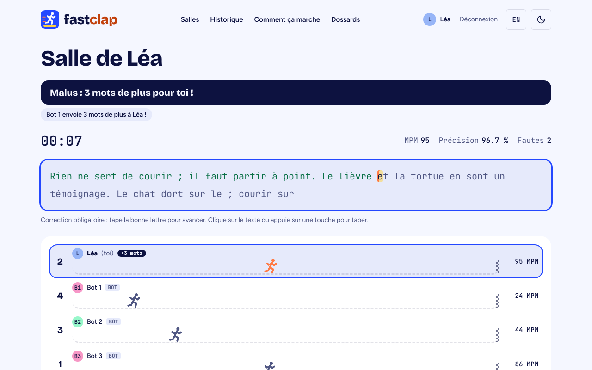
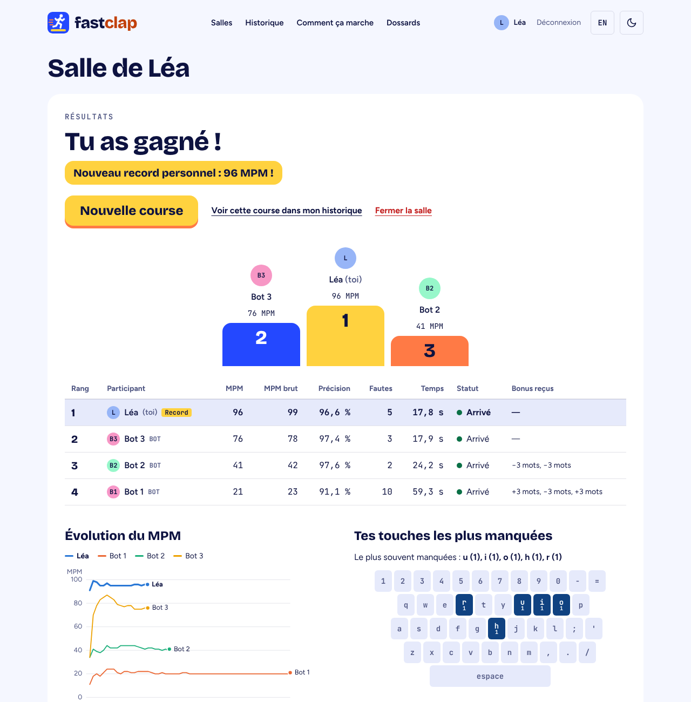
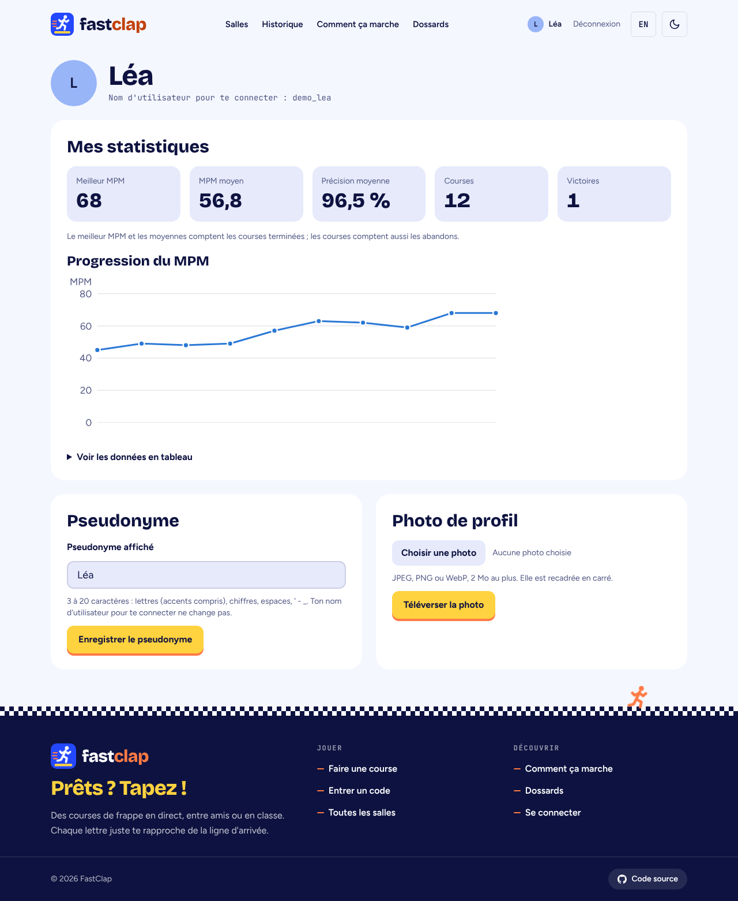
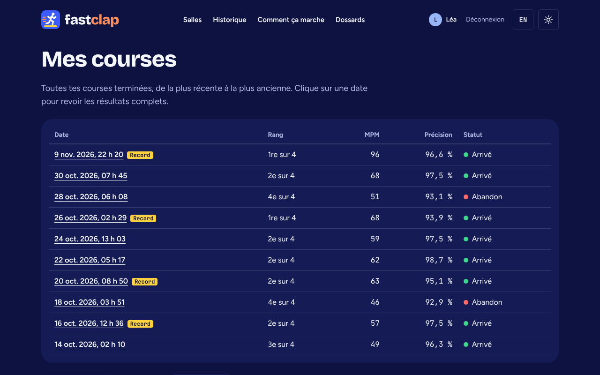

# FastClap

Course de frappe au clavier multijoueur en temps réel. Les joueurs entrent dans
une salle avec un code de 6 caractères, tapent le même texte et voient la
progression des autres sur la piste. Des bots de cinq niveaux complètent la
salle, et des bonus de remontée gardent la course serrée.

**Production : https://fastclap-production.up.railway.app**

| Accueil                                      | Salle d'attente                                            |
| -------------------------------------------- | ---------------------------------------------------------- |
|  |  |
| **Course**                                   | **Résultats**                                              |
|    |            |
| **Profil**                                   | **Historique (thème sombre)**                              |
|    |   |

## Compte de démonstration

Sur `/connexion`, section « J'ai un mot de passe » :

| Nom d'utilisateur | Mot de passe    |
| ----------------- | --------------- |
| `demo_lea`        | `fastclap-demo` |

`demo_max` et `demo_zoe` ont le même mot de passe. Chaque compte a 12 courses
dans son historique.

## Technologies

Next.js 16 (App Router), React 19, TypeScript strict, Tailwind CSS 4,
Socket.IO, PostgreSQL avec Prisma 7, Auth.js v5, Zod, Vitest, Playwright,
GitHub Actions. Hébergement : Railway (Docker, HTTPS) et Neon (PostgreSQL).

## Installation locale

Il faut Node.js 22 et Docker.

```bash
npm install
cp .env.example .env     # puis donner une valeur à AUTH_SECRET (npx auth secret)
docker compose up -d     # PostgreSQL local
npm run db:migrate       # tables
npm run db:seed          # textes et comptes de démonstration
npm run dev              # http://localhost:3000
```

## Variables d'environnement

Documentées dans [`.env.example`](.env.example). Aucun secret n'est commité.

| Variable                                 | Rôle                                                                    |
| ---------------------------------------- | ----------------------------------------------------------------------- |
| `DATABASE_URL`                           | Connexion PostgreSQL                                                    |
| `AUTH_SECRET`                            | Signe les sessions, les jetons temps réel et le cookie des invités      |
| `AUTH_TRUST_HOST`                        | `true` derrière un proxy (Railway) et pour `npm start`                  |
| `AUTH_DISCORD_ID`, `AUTH_DISCORD_SECRET` | Connexion Discord                                                       |
| `AUTH_GITHUB_ID`, `AUTH_GITHUB_SECRET`   | Connexion GitHub                                                        |
| `TRUST_PROXY_HEADER`                     | En-tête qui porte la vraie IP derrière le proxy (Railway : `x-real-ip`) |
| `PORT`                                   | Port du serveur (3000 par défaut)                                       |

## Tests

```bash
npm run lint        # ESLint et Prettier
npm run typecheck   # tsc --noEmit
npm test            # tests unitaires (Vitest)
npm run test:e2e    # tests de bout en bout (Playwright, base locale requise)
```

La CI lance le lint, les types et les tests unitaires à chaque push, puis les
tests de bout en bout sur le build de production avec PostgreSQL.

## Déploiement

Railway construit l'image avec le [`Dockerfile`](Dockerfile) à chaque push sur
`main`. Au démarrage du conteneur : migrations (`db:deploy`), seed, puis
serveur. Railway attend que `/api/health` réponde avant de basculer le trafic.

## Documentation

- [Architecture](docs/ARCHITECTURE.md) : modèle de données, machine à états,
  flux temps réel, ADR
- [Exigences](docs/EXIGENCES.md) : matrice de traçabilité et choix documentés
- [Démarche créative](docs/DEMARCHE-CREATIVE.md)
- [Utilisation de l'IA](docs/IA.md)
- [Design UI/UX](docs/UI-UX.md)
