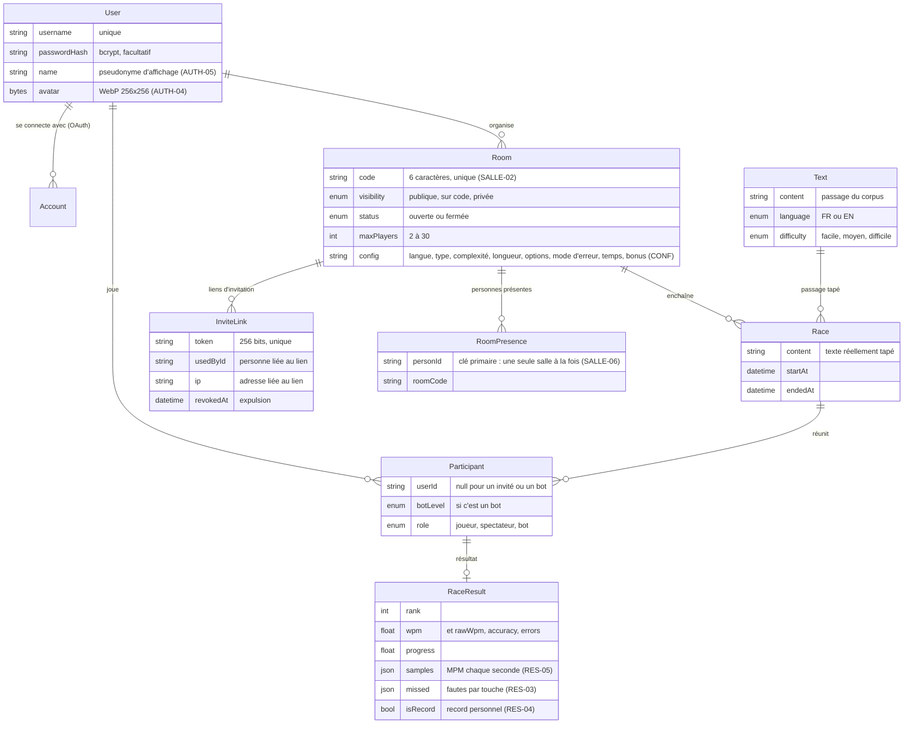
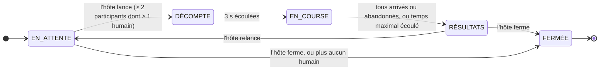
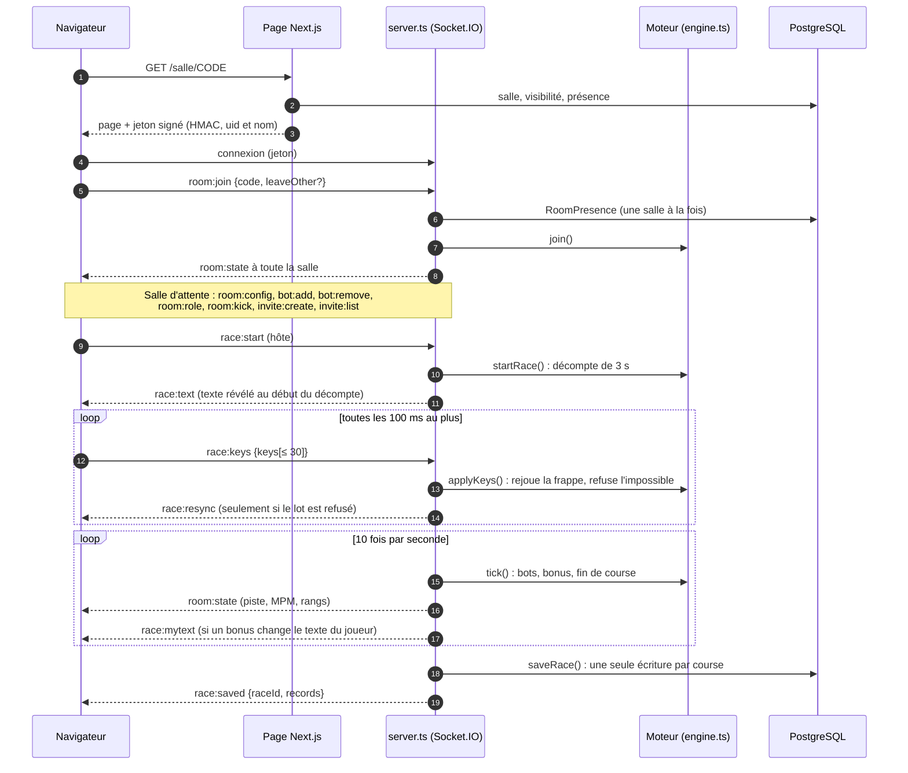

# Architecture

FastClap tourne sur un seul serveur Node (Next.js + Socket.IO) hébergé sur
Railway, avec une base PostgreSQL chez Neon.

## 1. Modèle de données

Une salle (`Room`) garde son code et sa configuration ; chaque partie est une
course (`Race`). `Participant` relie un utilisateur, un invité ou un bot à une
course ; `RaceResult` garde son résultat et sa courbe de MPM. Les invités n'ont
pas de ligne `User` (cookie signé). `Account`, `Session` et
`VerificationToken` sont les tables d'Auth.js. Schéma complet :
[`prisma/schema.prisma`](../prisma/schema.prisma).

## 2. Machine à états d'une course (COURSE-01)

Dans le code (`src/lib/race/engine.ts`), les états s'appellent `WAITING`,
`COUNTDOWN`, `RUNNING`, `RESULTS` et `CLOSED`. Le moteur est du code pur : le
temps lui est passé en paramètre, ce qui permet de tester chaque transition
(`engine.test.ts`).

| Transition             | Garde                                                                     |
| ---------------------- | ------------------------------------------------------------------------- |
| EN_ATTENTE → DÉCOMPTE  | Demandée par l'hôte ; ≥ 2 participants connectés, dont ≥ 1 humain         |
| DÉCOMPTE → EN_COURSE   | Heure de départ atteinte (fixée par le serveur au lancement)              |
| EN_COURSE → RÉSULTATS  | Plus aucun coureur en course (arrivé, abandon, temps écoulé, 30 s absent) |
| RÉSULTATS → EN_ATTENTE | Demandée par l'hôte                                                       |
| → FERMÉE               | Demandée par l'hôte, ou départ du dernier humain (SALLE-08)               |

On n'entre dans une salle qu'en EN_ATTENTE ou RÉSULTATS (SALLE-09). Une
personne déjà membre peut toujours revenir : c'est la reprise après un
rechargement (COURSE-08).

## 3. Flux des messages temps réel

Tous les messages passent par Socket.IO sur le même port que Next.js. Chaque
message reçu est validé par un schéma Zod (`src/lib/race/messages.ts`) ; un
message invalide est ignoré (TECH-07). Les actions réservées à l'hôte sont
vérifiées par le moteur, pas par l'interface (SEC-01).

- **Navigateur → serveur** : `room:join`, `room:leave`, `room:role`,
  `room:config`, `room:kick`, `room:lobby`, `room:close`, `bot:add`,
  `bot:remove`, `invite:create`, `invite:list`, `race:start`, `race:keys`,
  `race:abandon`.
- **Serveur → navigateur** : `room:state` (état complet, 10 fois par seconde),
  `race:text`, `race:mytext` (texte changé par un bonus), `race:resync`,
  `race:saved`, `invite:update`, `room:moved`, `room:kicked`.

L'explorateur de salles (JOIN-02) relit `/api/salles` toutes les 3 secondes.

## 4. ADR — Temps réel avec Socket.IO

**Contexte.** Jusqu'à 30 joueurs tapent en même temps et doivent voir le rang et
la vitesse des autres en direct. Le serveur doit aussi refuser une mauvaise
lettre.

**Décision.** J'utilise Socket.IO dans le même serveur que Next.js
([`server.ts`](../server.ts)). Pendant la course, le navigateur regroupe les
touches et les envoie par lots, au plus 10 fois par seconde (PERF-02). Le
serveur les rejoue avec les mêmes règles que le navigateur
(`src/lib/race/typing.ts`), refuse ce qui est impossible, puis diffuse l'état de
la salle 10 fois par seconde. Le navigateur affiche sa propre frappe tout de
suite ; si le serveur refuse un lot, il renvoie son état et le navigateur s'y
aligne (COURSE-06).

**Options écartées.** Requêtes HTTP répétées (trop lentes), Server-Sent Events
(un seul sens), service hébergé comme Pusher (payant).

**Conséquences.** Il faut un serveur Node toujours allumé, d'où Railway plutôt
que Vercel. L'état des courses vit en mémoire : très rapide, mais une course en
cours est perdue si le serveur redémarre (les comptes et les salles restent dans
la base).

## 5. ADR — Gestion des bots

**Contexte.** Les bots doivent ressembler à des humains (vitesse variable, fautes),
respecter le mode d'erreur, subir les bonus, et rester testables (BOT-05).

**Décision.** Les bots tournent sur le serveur, dans le même moteur que les
humains : à chaque `tick`, le bot calcule les touches qu'il aurait tapées depuis
le dernier passage et les applique avec les mêmes règles de frappe
(`typing.ts`). Le navigateur ne fait que les afficher.

**Options écartées.** Bots simulés dans le navigateur de l'hôte (triche possible,
et la course s'arrête si l'hôte part) ; progression calculée par une formule
sans frappe (pas de fautes réelles, pas de mode d'erreur, bonus incohérents).

**Conséquences.** Un bot coûte peu (aucune connexion réseau) ; 30 coureurs
tiennent sans peine dans un tick de 100 ms. Les tests rejouent une course entière
de bot en quelques millisecondes.

**Fonctionnement** (`src/lib/race/bots.ts`) :

- **Graine (BOT-05)** : tout le hasard vient de `random.ts` ; même graine, même
  frappe.
- **Vitesse variable (BOT-02)** : délai ±40 % entre les touches, rythme qui
  dérive d'un mot à l'autre, hésitations (12 % des mots), ralentissement sur
  les majuscules, chiffres, ponctuation, accents et mots longs.
- **Fautes (BOT-03)** : 250 à 700 ms de réaction, puis correction selon le mode
  d'erreur.

| Niveau        | MPM visé | Taux d'erreur |
| ------------- | -------- | ------------- |
| Noob          | 10–20    | 12 %          |
| Débutant      | 20–35    | 8 %           |
| Intermédiaire | 35–60    | 5 %           |
| Expert        | 70–100   | 2 %           |
| Impossible    | 140–170  | 0,5 %         |

Le MPM visé est tiré dans la plage à chaque course ; le rythme de base est
accéléré de 20 % pour compenser les hésitations et les fautes
(`bots.test.ts` vérifie la moyenne sur 20 graines par niveau).
