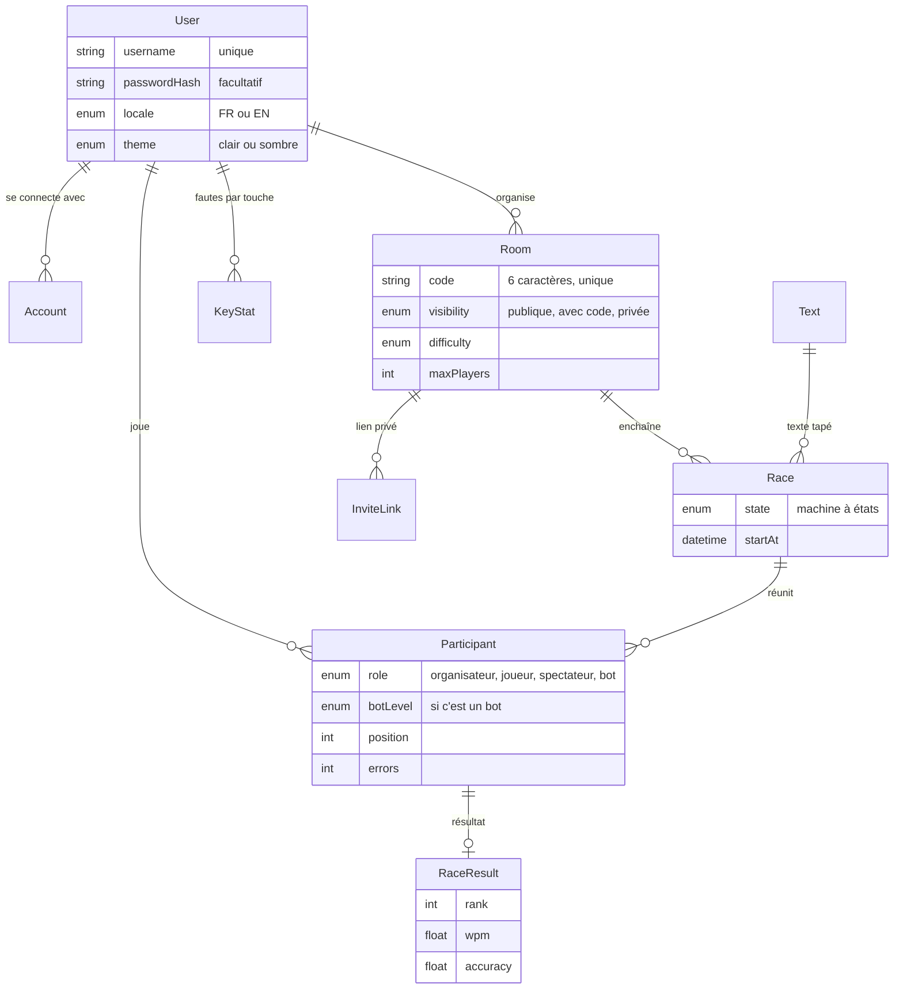
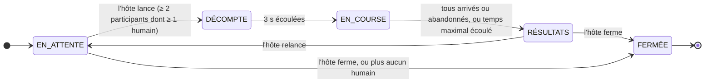

# Architecture (version initiale)

FastClap tourne sur un seul serveur Node (Next.js + Socket.IO) hébergé sur
Railway, avec une base PostgreSQL chez Neon.

## 1. Modèle de données

Une salle (`Room`) garde son code à 6 caractères et ses réglages ; chaque partie
jouée dedans est une course (`Race`), ce qui permet de relancer sans recréer la
salle. Un `Participant` relie un joueur, un invité ou un bot à une course, et son
résultat final est gardé dans `RaceResult`. Le schéma complet est dans
[`prisma/schema.prisma`](../prisma/schema.prisma), et les migrations dans
`prisma/migrations/`.

## 2. Machine à états d'une course (COURSE-01)

Dans le code (`src/lib/race/engine.ts`), les états s'appellent `WAITING`,
`COUNTDOWN`, `RUNNING`, `RESULTS` et `CLOSED`. Le moteur est du code pur : le
temps lui est passé en paramètre, ce qui permet de tester chaque transition
(`engine.test.ts`).

| Transition             | Garde                                                                     |
| ---------------------- | ------------------------------------------------------------------------- |
| EN_ATTENTE → DÉCOMPTE  | Demandée par l'hôte ; ≥ 2 participants connectés, dont ≥ 1 humain         |
| DÉCOMPTE → EN_COURSE   | Heure de départ atteinte (fixée par le serveur au lancement)              |
| EN_COURSE → RÉSULTATS  | Plus aucun coureur en course (arrivé, abandon, temps écoulé, 30 s absent) |
| RÉSULTATS → EN_ATTENTE | Demandée par l'hôte                                                       |
| → FERMÉE               | Demandée par l'hôte, ou départ du dernier humain (SALLE-08)               |

On n'entre dans une salle qu'en EN_ATTENTE ou RÉSULTATS (SALLE-09). Une
personne déjà membre peut toujours revenir : c'est la reprise après un
rechargement (COURSE-08).

## 3. ADR — Temps réel avec Socket.IO

**Contexte.** Jusqu'à 30 joueurs tapent en même temps et doivent voir le rang et
la vitesse des autres en direct. Le serveur doit aussi refuser une mauvaise
lettre.

**Décision.** J'utilise Socket.IO dans le même serveur que Next.js
([`server.ts`](../server.ts)). Pendant la course, le navigateur regroupe les
touches et les envoie par lots, au plus 10 fois par seconde (PERF-02). Le
serveur les rejoue avec les mêmes règles que le navigateur
(`src/lib/race/typing.ts`), refuse ce qui est impossible, puis diffuse l'état de
la salle 10 fois par seconde. Le navigateur affiche sa propre frappe tout de
suite ; si le serveur refuse un lot, il renvoie son état et le navigateur s'y
aligne (COURSE-06).

**Options écartées.** Requêtes HTTP répétées (trop lentes), Server-Sent Events
(un seul sens), service hébergé comme Pusher (payant).

**Conséquences.** Il faut un serveur Node toujours allumé, d'où Railway plutôt
que Vercel. L'état des courses vit en mémoire : très rapide, mais une course en
cours est perdue si le serveur redémarre (les comptes et les salles restent dans
la base).

## 4. Bots

Les bots sont des participants simulés par le serveur (`src/lib/race/bots.ts`).
Ils tapent touche par touche avec les mêmes règles que les humains, donc avec
le même mode d'erreur (BOT-03), et apparaissent sur la piste et dans les
résultats avec la mention « BOT » (BOT-04).

- **Déterministes (BOT-05) :** tout le hasard vient d'un générateur à graine
  (`random.ts`). À graine égale, le bot tape exactement pareil, quelle que soit
  la fréquence à laquelle le serveur le fait avancer.
- **Vitesse variable (BOT-02) :** délai aléatoire entre deux touches (±40 %),
  rythme qui dérive d'un mot à l'autre (80 à 120 %), hésitations entre les mots
  (12 % des mots, 150 à 600 ms), ralentissement sur les majuscules, chiffres,
  ponctuation et accents (×1,3 à ×1,9) et sur les mots de 8 lettres et plus.
- **Fautes (BOT-03) :** une faute coûte 250 à 700 ms de réaction. En correction
  obligatoire, le bot retape la bonne lettre ; en mode libre, il efface sa faute.

| Niveau        | MPM visé | Taux d'erreur |
| ------------- | -------- | ------------- |
| Noob          | 10–20    | 12 %          |
| Débutant      | 20–35    | 8 %           |
| Intermédiaire | 35–60    | 5 %           |
| Expert        | 70–100   | 2 %           |
| Impossible    | 140–170  | 0,5 %         |

Le MPM visé est tiré au hasard dans la plage à chaque course. Les hésitations
et les fautes coûtent environ 20 % de vitesse : le rythme de base est accéléré
d'autant pour que le MPM final moyen tombe dans la plage (vérifié par
`bots.test.ts` sur 20 graines par niveau).
