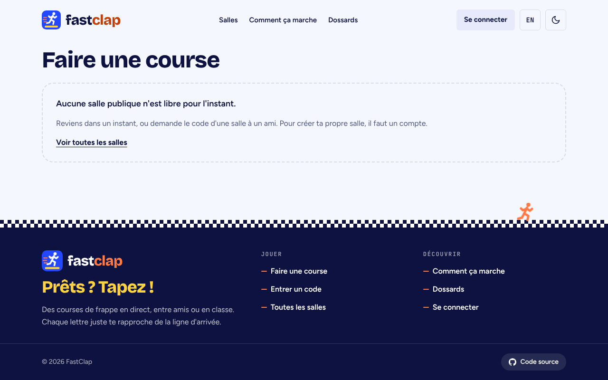
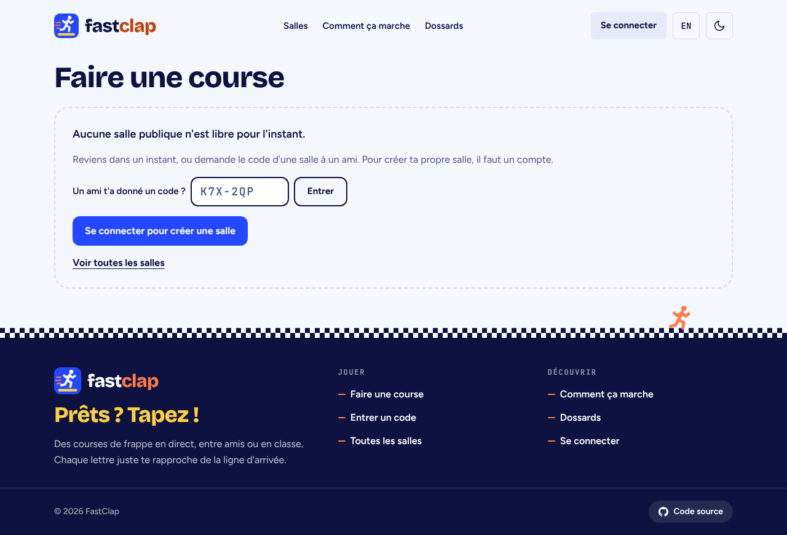
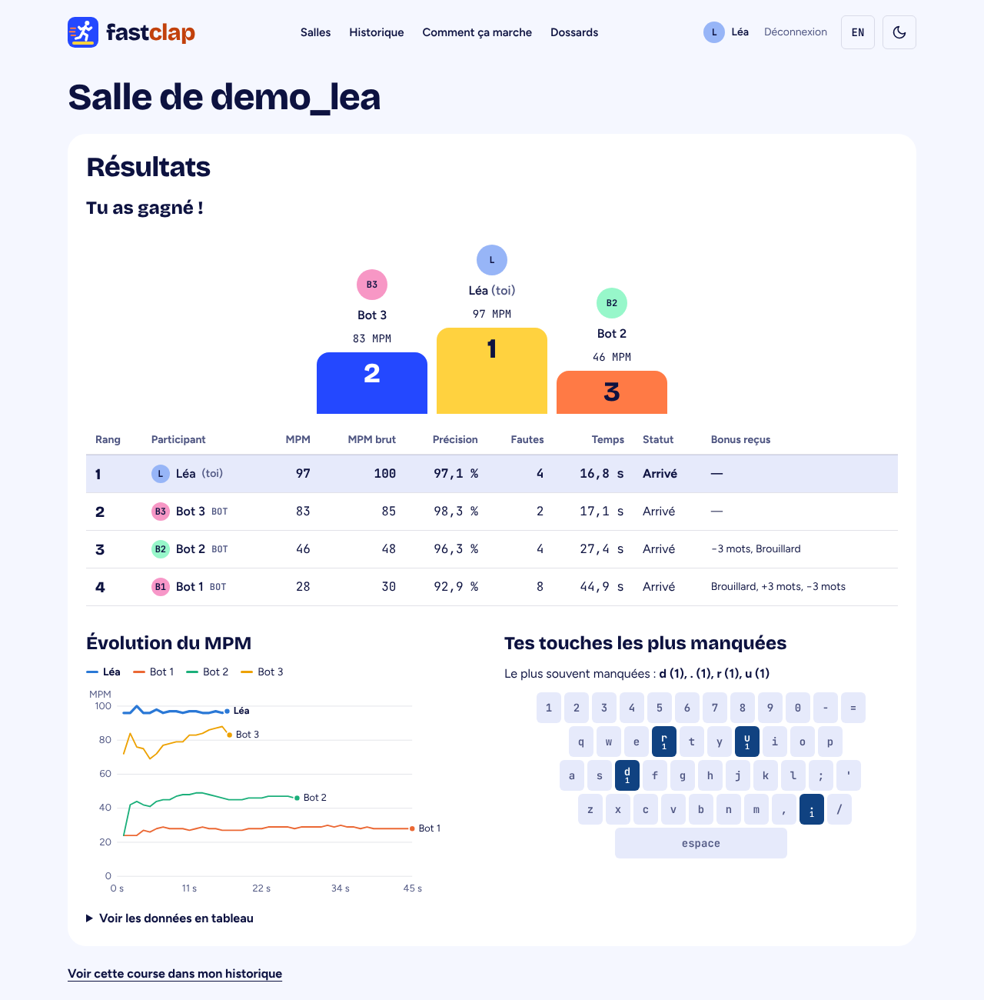
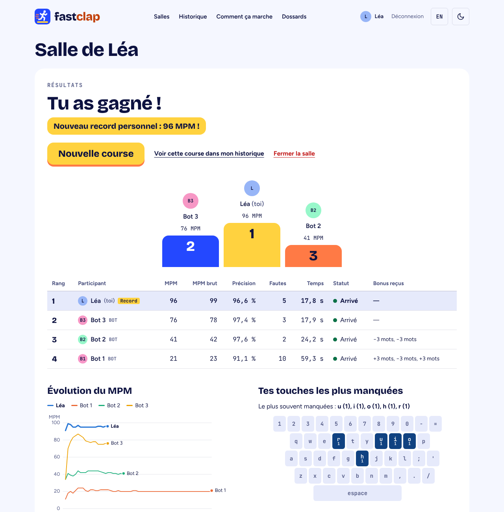
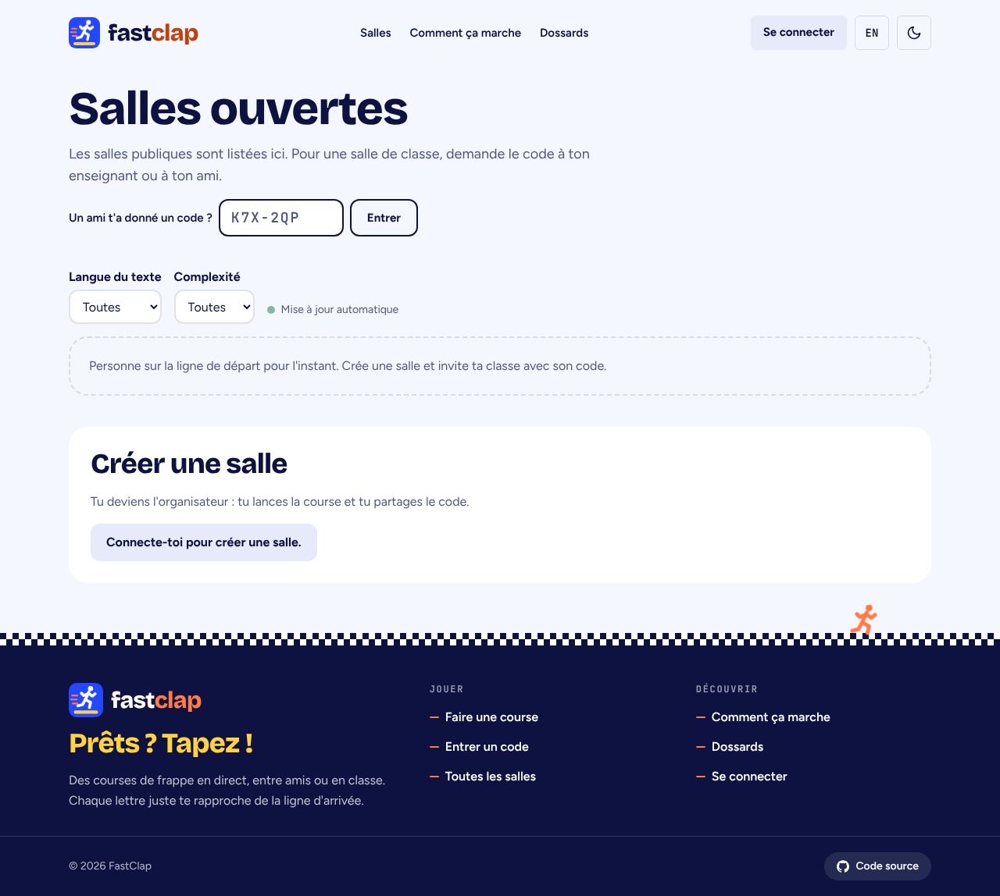
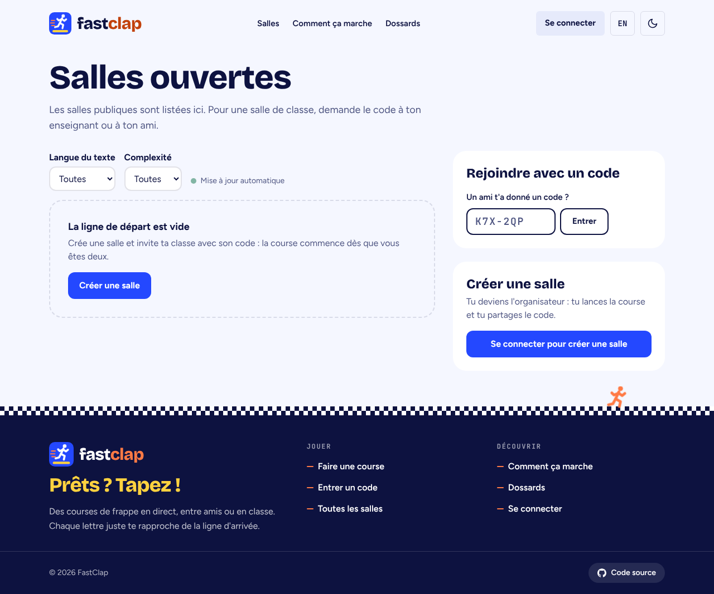
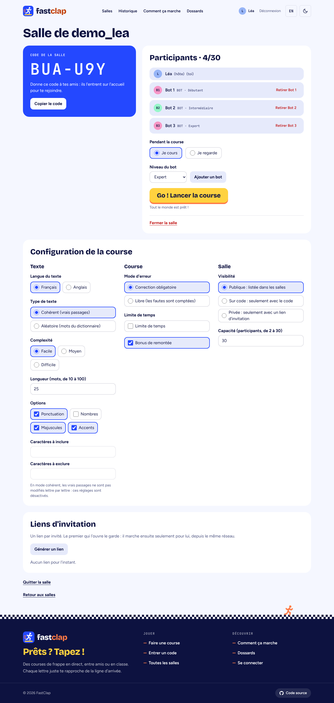
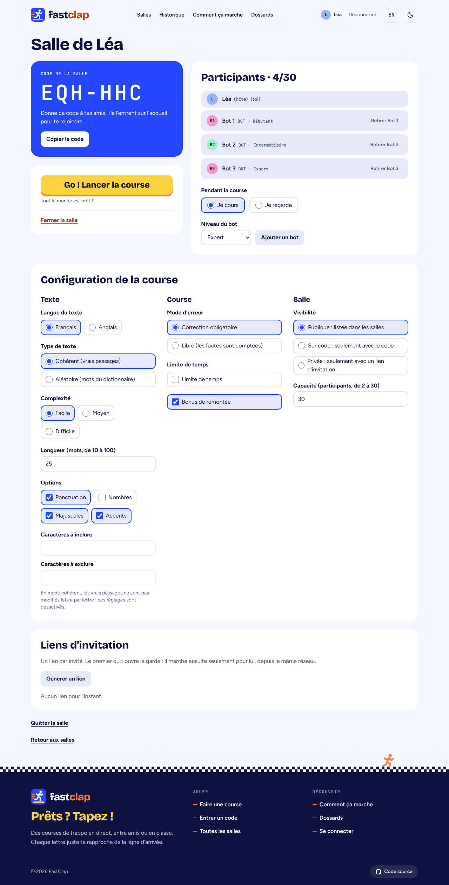
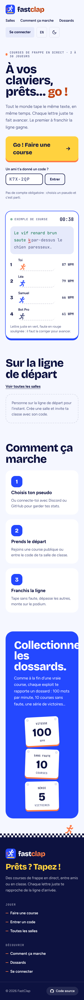
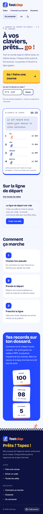

# Retravail UI/UX

Passe de design faite après le cours sur le design d'interface, sur cinq
thèmes : planifier un design, structure et espacement, hiérarchie, design du
texte, couleurs. Le nom, le logo, la palette et les typographies de la
[démarche créative](DEMARCHE-CREATIVE.md) ne changent pas : on change la façon
de les utiliser, pas l'identité.

## 1. Planifier un design : partir de la fonction

Une page se conçoit autour de ce que la personne vient y faire, et elle ne
promet que ce que le site fait vraiment.

- **Dossards honnêtes.** La section « Collectionne les dossards » annonçait
  des récompenses (série de victoires, 10 courses sans faute) qui n'existent
  pas dans le jeu. Les dossards penchés restent (direction artistique), mais
  ils montrent maintenant ce que le profil garde vraiment : record, précision
  moyenne, victoires (AUTH-06, RES-04).
- **États vides utiles.** Un état vide dit ce qui se passe et offre l'action
  qui le règle. « Personne sur la ligne de départ » devient un titre, une
  phrase et un bouton « Créer une salle ». Sur « Faire une course », l'invité
  peut maintenant entrer un code ou se connecter, au lieu d'un cul-de-sac.
- **Unité cohérente.** La course d'exemple de l'accueil affichait « WPM » en
  français ; elle affiche « MPM », comme le reste du site (I18N-01).

| Avant                               | Après                               |
| ----------------------------------- | ----------------------------------- |
|  |  |

## 2. Hiérarchie : une action principale par écran

Tout n'a pas la même importance. L'action principale est la plus visible ;
les actions secondaires sont des liens ; les actions destructrices sont en
retrait et demandent une confirmation.

- **Résultats.** Le verdict (« Tu as gagné ! », « 3e sur 4 ») est le vrai
  titre, en grand ; « Résultats » devient une petite étiquette. Les actions
  sont juste à côté, sans faire défiler : « Nouvelle course » (bouton
  principal), « Voir dans l'historique » (lien), « Fermer la salle » (lien
  rouge, avec confirmation). Avant, elles étaient sous les graphiques.
- **Salle d'attente.** « Lancer la course » était au milieu de la colonne de
  droite, après les participants et les bots. Il est maintenant sous le code,
  dans une colonne qui reste visible quand on fait défiler la configuration.
- **Retirer un bot, expulser.** Ces boutons étaient rouges sur chaque ligne et
  attiraient l'œil plus que les noms. Ils sont gris et deviennent rouges au
  survol.

| Avant                                      | Après                                      |
| ------------------------------------------ | ------------------------------------------ |
|  |  |

## 3. Structure et espacement : regrouper ce qui va ensemble

- **Page des salles.** Le code, les filtres, la liste et la création étaient
  empilés les uns sous les autres. La liste est le contenu principal, à
  gauche ; « Rejoindre avec un code » et « Créer une salle » sont deux cartes
  à droite, chacune avec son titre.
- **Salle d'attente.** La colonne du code laissait un grand vide sous elle ;
  elle porte maintenant le départ, et reste en place (`sticky`) pendant le
  défilement.
- **Moins de bordure, plus d'espace.** Les cartes gardent leurs coins arrondis
  et leurs fonds clairs ; l'espace intérieur augmente sur grand écran
  (`sm:p-8`) au lieu d'ajouter des traits.

| Avant                                          | Après                                          |
| ---------------------------------------------- | ---------------------------------------------- |
|         |         |
|  |  |

## 4. Design du texte : une échelle, et des titres qui tiennent

- **Échelle des titres.** Les titres de page suivent la même échelle :
  `text-4xl` sur téléphone, `text-5xl` dès 640 px (la page des salles et la
  page introuvable montent jusqu'à `text-6xl`). Avant, chaque page avait sa taille, et les
  titres en `text-5xl` débordaient à 360 px : « Collectionne » sortait de
  l'écran.
- **`text-balance`** sur les titres : les lignes ont une longueur proche, sans
  mot seul sur la dernière ligne.
- **Longueur de ligne.** Les paragraphes restent sous 40 em environ, pour une
  lecture confortable.
- **Avatars.** L'initiale de l'avatar du profil était en très petit dans un
  grand rond ; sa taille suit maintenant celle du rond.
- **Nom affiché.** Le titre d'une salle utilise le pseudonyme d'affichage
  (« Salle de Léa ») plutôt que le nom d'utilisateur (« Salle de demo_lea »).

| Avant                                           | Après                                           |
| ----------------------------------------------- | ----------------------------------------------- |
|  |  |

## 5. Couleurs : un sens par couleur, jamais seule

La palette ne change pas ; chaque couleur garde un seul rôle.

| Couleur | Rôle                                                                |
| ------- | ------------------------------------------------------------------- |
| Jaune   | L'action principale de l'écran (un seul bouton jaune à la fois)     |
| Bleu    | Actions secondaires pleines (« Créer une salle »), sélection, piste |
| Vert    | Juste : lettre correcte, coureur arrivé                             |
| Rouge   | Faute, abandon, action destructrice                                 |
| Gris    | Texte secondaire et actions en retrait                              |

- **Statuts.** Dans les résultats et l'historique, chaque statut a une
  pastille : vert « Arrivé », jaune « Temps écoulé », rouge « Abandon ». Le
  mot reste écrit à côté : la couleur n'est jamais seule à porter
  l'information (A11Y-01).
- **Contraste.** Toutes les pages repassent l'audit axe (WCAG 2.1 AA) dans les
  deux thèmes, et le test d'affichage à 360 px (`e2e/a11y.spec.ts`,
  `e2e/mobile.spec.ts`).
